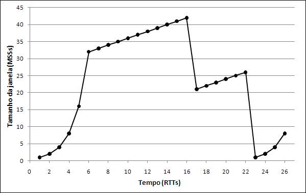

# Ficha de Exercícios nº 7

*Última alteração: segunda-feira, 14 de setembro de 2026 às 17:41*

1. **Controla o quê?**  Explique as diferenças entre o controlo de fluxo e o controlo de congestionamento na camada de transporte, identificando para cada um os objectivos e a entidade activa.
2. **Hello Goodbye:**  Tendo em conta o modo como são estabelecidas e terminadas as conexões TCP, 
      1. Explique com algum detalhe o que é o three-way handshake, para que serve e como se processa.
      2. Explique como se terminam as conexões TCP.
3. **Timeout:** Recorde o mecanismo utilizado pelo TCP para estimar o RTT. Suponha que α=0.1. Seja SampleRTT(1) a amostra mais recente, e seja SampleRTT(2) a segunda mais recente, etc... 
      1. Para uma dada conexão TCP, suponha que houve 4 ACKs, correspondendo a amostras do RTT indexadas por SampleRTT(4), SampleRTT(3), SampleRTT(2) e SampleRTT(1). Escreva o resultado EstimatedRTT em função destas quatro amostras.
      2. Generalize a formula para *n*  amostras.
      3. Porque é que se dá o nome de média móvel exponencial?
      4. Suponha que os valores RTT medido para os primeiros pacotes de uma conexão TCP foram, respectivamente, 54, 63, 55, 57, 68, 56, 55 e 58 ms. Se nesse momento for transmitido o primeiro pacote de uma janela, que valor será usado para o *timeout* ? (Suponha que β=0.2, que o valor inicial da estimativa é igual ao RTT da primeira amostra, e que o valor inicial do desvio é igual a metade do RTT da primeira amostra.)
      5. Faria alguma diferença se algum dos pacotes indicados na alínea anterior tivesse sido retransmitido? Explique como e porquê.
      6. O que faz o TCP se, de repente, o RTT aumentar muito, originando *timeouts*  sucessivos? Porquê?
4. **Controlo de Congestionamento:** Considere que a figura em anexo representa o tamanho da janela TCP (Reno) em função do tempo. 
   
    
   **Figura 1:** Janela de congestionamento
    
      1. Identifique os intervalos de tempo em que o TCP opera no modo slow start.
      2. Identifique os intervalos de tempo em que o TCP está em congestion avoidance.
      3. Ao fim da 16ª ronda de transmissão, a perda é assinalada por um triplo ACK duplicado ou um timeout?
      4. Ao fim da 22ª ronda de transmissão, a perda é assinalada por um triplo ACK duplicado ou um timeout?
      5. Qual é o valor inicial do limiar na primeira ronda de transmissão?
      6. Qual o valor do limiar na 18ª ronda de transmissão?
      7. Qual o valor do limiar na 24ª ronda de transmissão?
      8. Em que ronda de transmissão é transmitido o 70º segmento?
      9. Partindo do princípio que uma perda é detectada após a 26ª ronda pela recepção de um triplo ACK duplicado, quais serão os valores da janela de congestionamento e do limiar?
5. **Janela de Congestionamento:** Determine em função do tamanho da janela de congestionamento CongWin e do MSS, qual o incremento que o TCP deve fazer à janela de congestionamento por cada ACK recebido nos seguintes casos: 
      1. A janela de congestionamento deve duplicar em cada RTT
      2. A janela de congestionamento deve aumentar 1 MSS por cada RTT.
6. **TCPs há muitos, seu palerma...** Procure por duas ou mais versões diferentes do TCP e explique as principais diferenças entre elas.
